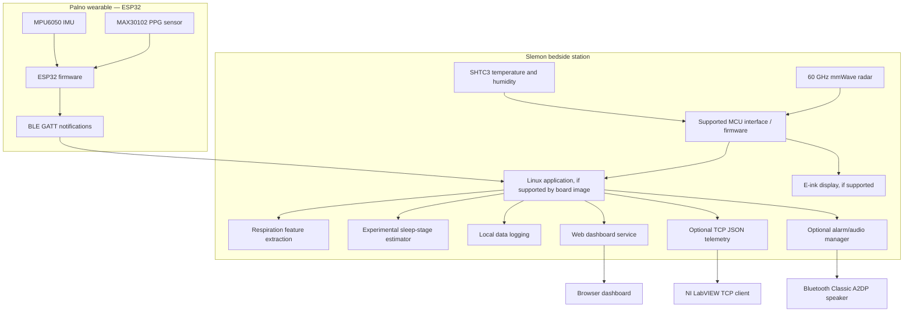

# Palno & Slemon: Contactless Dual-Node Sleep-Tracking System

> **Smart Home and Healthcare Challenge Entry**
>
> A prototype sleep-monitoring ecosystem combining contactless mmWave sensing, a wearable PPG/IMU node, experimental sleep-stage estimation, telemetry for NI LabVIEW, a web dashboard, and an optional Bluetooth-audio alarm.

> **Prototype and safety notice:** This project is for experimentation and wellness-oriented trend tracking. It is not a medical device, does not diagnose sleep disorders, and has not been established as clinical-grade. MAX30102 SpO₂ values are estimates and may be inaccurate due to motion, fit, perfusion, ambient light, or sensor limitations. Do not use this system for medical decisions.

---

## Contents

- [System overview](#system-overview)
- [Architecture](#architecture)
- [Hardware and wiring](#hardware-and-wiring)
- [Repository layout](#repository-layout)
- [Setup and installation](#setup-and-installation)
- [Telemetry and LabVIEW](#telemetry-and-labview)
- [Sleep-stage estimation](#sleep-stage-estimation)
- [Smart alarm](#smart-alarm)
- [Known limitations and validation checklist](#known-limitations-and-validation-checklist)
- [License and acknowledgments](#license-and-acknowledgments)

## System overview

Palno & Slemon is a proposed two-node prototype. The exact features available depend on the hardware revisions, firmware, Linux image, drivers, and software implemented in the repository.

### 1. Slemon bedside station — Arduino Uno Q

Intended responsibilities:

- Read a compatible 60 GHz mmWave radar module over UART.
- Read an SHTC3 temperature/humidity sensor over I²C.
- Render status and estimated sleep information on an e-ink display, if the selected display and driver are supported.
- Run the higher-level Python application on the Linux processor, where supported by the installed Arduino Uno Q software environment.
- Provide telemetry to a web dashboard and an optional LabVIEW TCP client.

**Architecture verification required:** confirm the exact processor names, board communication mechanism, and supported App Lab deployment format against the documentation for your Uno Q hardware and installed software version. Do not assume that a generic RouterBridge RPC interface, arbitrary Docker configuration, or direct STM32 peripheral access is available unless the board software exposes it.

### 2. Palno wearable node — ESP32-WROOM-DA

Intended responsibilities:

- Read MAX30102 red/infrared PPG samples over I²C.
- Read MPU6050 accelerometer and gyroscope samples over the same I²C bus.
- Calculate experimental heart-rate and SpO₂ estimates from sufficiently good PPG windows.
- Calculate motion/restlessness features from IMU samples.
- Publish data through a BLE GATT service.

The MAX30102 and MPU6050 share SDA/SCL but use different I²C addresses in the usual configuration: `0x57` and `0x68`. Verify the actual addresses with an I²C scanner. Both modules must use compatible logic levels and a common ground.

### 3. Telemetry, dashboard, and audio

- **LabVIEW TCP:** optional newline-delimited JSON telemetry. The server and client must agree on the port, line terminator, field names, and data types.
- **Web dashboard:** optional browser UI using a web server and WebSocket/Socket.IO transport. The server implementation must match the JavaScript client and its dependencies.
- **Bluetooth audio:** optional audio output through a paired Bluetooth Classic A2DP speaker. BLE GATT sensor communication does not itself provide A2DP audio; the Linux host must support the relevant Bluetooth profiles and audio stack.

---

## Architecture

The following is a **logical architecture**, not proof that every link is already implemented. Replace component labels or links to match the actual board and source code.



---

## Hardware and wiring

### 1. Palno wearable node (ESP32-WROOM-DA)

| Component | Interface | ESP32 connection | Notes |
|---|---|---|---|
| ESP32-WROOM-DA | — | — | Confirm the exact development-board pin labels. |
| MAX30102 | I²C | SDA → GPIO 21; SCL → GPIO 22; INT → GPIO 4 (optional); VIN → module-supported supply | I²C address is commonly `0x57`. Check the breakout board's voltage and pull-up circuitry before powering it. |
| MPU6050 | I²C | SDA → GPIO 21; SCL → GPIO 22; VCC → module-supported supply; GND → GND | Address is commonly `0x68`, or `0x69` when AD0 is high. |
| Status LED | GPIO | GPIO 2, if available on the development board | LED polarity and onboard wiring vary by board. |

**Wiring checks**

1. Connect all grounds together.
2. Ensure the I²C pull-ups do not pull the bus above the ESP32's permitted GPIO voltage.
3. Check the actual module supply requirements; do not assume every breakout accepts 3.3 V or 5 V.
4. Use an I²C scanner before running the application.
5. Start with a lower I²C clock if wiring is long or unreliable.

### 2. Slemon bedside station (Arduino Uno Q)

| Peripheral | Intended interface | Required verification |
|---|---|---|
| mmWave radar | UART | Confirm the radar model, baud rate, voltage levels, packet format, and supported MCU pins. |
| SHTC3 | I²C | Confirm the selected I²C bus, address, and compatible library. |
| E-ink display | Usually SPI, depending on the display | Confirm controller, resolution, voltage, reset/busy pins, and supported driver. |
| Linux application | Board-supported IPC | Use the inter-processor communication interface documented for the installed Uno Q image. |
| Bluetooth speaker | Bluetooth Classic A2DP | Confirm that the Linux image and audio stack support A2DP sink/source roles as required by the speaker workflow. |

The speaker MAC address, radar model, pin assignments, and processor/interface names should be documented only after they have been verified on the actual hardware.

---

## Repository layout

This is a suggested layout. Keep only files and services that exist in the repository; a README should not imply that unimplemented modules are available.

```text
.
├── Palno/
│   └── palno_esp32/
│       ├── palno_esp32.ino
│       ├── ble_service.h
│       ├── biometrics.h
│       ├── motion.h
│       ├── algorithm.h
│       ├── algorithm.cpp
│       ├── max30102.h
│       └── max30102.cpp
├── sketch/
│   ├── sketch.ino
│   ├── radar_parser.h
│   ├── eink_display.h
│   ├── temp_sensor.h
│   └── sketch.yaml
├── python/
│   ├── main.py
│   ├── requirements.txt
│   └── engine/
│       ├── ble_client.py
│       ├── breath_engine.py
│       ├── sleep_classifier.py
│       ├── labview_bridge.py
│       ├── alarm_manager.py
│       ├── bluetooth_manager.py
│       ├── data_logger.py
│       ├── serial_bridge.py
│       └── config.py
├── assets/
│   ├── index.html
│   ├── style.css
│   └── app.js
├── audio/
│   ├── sleep_induction_delta.wav
│   └── wake_circadian_alpha.wav
├── slemon_startup.sh
├── bt_host_agent.py
├── app.yaml
├── LICENSE
└── README.md
```

---

## Setup and installation

These steps are a starting checklist. Exact steps depend on the repository contents and the Arduino Uno Q software version.

### Step 1: Build and flash the ESP32

1. Install the [Arduino IDE](https://www.arduino.cc/en/software).
2. Install the **ESP32 by Espressif Systems** board package through Boards Manager.
3. Open `Palno/palno_esp32/palno_esp32.ino`.
4. Select the correct ESP32 board and serial port.
5. Install any libraries required by the source code and confirm their versions.
6. Compile and upload the firmware.
7. Open Serial Monitor and verify sensor detection, PPG signal quality, IMU readings, and BLE advertising.

The advertised device name and service UUID must match the values actually defined in `ble_service.h`; do not rely on example UUIDs unless they are configured in the firmware.

### Step 2: Deploy the Slemon application

1. Check the current Arduino Uno Q documentation for the supported App Lab workflow and project format.
2. Verify the project manifest and required files before packaging.
3. Install Python dependencies in the environment supported by the board.
4. Configure BLE access, sensor interfaces, data storage, and network binding.
5. Start the application and inspect logs before configuring automatic startup.

Do not assume that uploading an arbitrary ZIP automatically compiles an MCU sketch, starts a Docker container, or installs Linux system services. Those behaviors must be supported by the installed board software and explicitly configured.

### Step 3: Configure networking and services

Before enabling startup services, confirm that each script and service exists and works when launched manually.

- **BLE access:** verify that BlueZ is running and that the Python BLE library can access the host Bluetooth adapter. Containerized deployments may need a documented D-Bus/socket access configuration.
- **TCP telemetry:** ensure port `5005` is listening on the intended interface and is reachable from the LabVIEW machine. Bind to loopback if remote access is not required; otherwise restrict access with firewall rules.
- **Dashboard:** ensure port `7000` is listening on the intended interface and that the front end and server use compatible Socket.IO versions.
- **Bluetooth audio:** verify the host's Bluetooth audio support and test manual pairing and playback before enabling automatic connection.
- **Startup:** only enable systemd units after confirming their paths, permissions, dependencies, restart behavior, and logs.

Do not expose telemetry ports to untrusted networks without access controls. Biometric data should be treated as sensitive personal data.

---

## Telemetry and LabVIEW

The proposed TCP interface sends one JSON object per line, terminated by `\n` or `\r\n`. Pick one line ending and use it consistently on both ends. TCP is a byte stream, so a client must buffer incoming bytes until a complete line is received; a single read is not guaranteed to return exactly one JSON message.

### Example JSON message

This is an **illustrative schema**, not a claim that the application currently produces these values.

```json
{
  "ts": 1792931468.36,
  "breath_bpm": 15.0,
  "hr_bpm": 71.0,
  "hr_valid": true,
  "spo2": 98.0,
  "spo2_valid": true,
  "room_temp_c": 28.27,
  "disturbance": 9.2,
  "sleep_stage": "WAKE",
  "sleep_stage_numeric": 4,
  "alarm_active": false,
  "ble_connected": true,
  "sleep_score": 85.0,
  "radar_mov_dist": 69.0,
  "radar_mov_energy": 0.0,
  "radar_stat_energy": 100.0,
  "accel_x": -0.125,
  "accel_y": 0.222,
  "accel_z": 0.981
}
```

### Field and type rules

- `ts`: Unix timestamp in seconds; document whether it is UTC and how the clock is synchronized.
- `*_valid`: Boolean validity flags. Use `true`/`false` consistently rather than mixing Booleans and integer flags.
- Missing or invalid measurements should be represented consistently, for example with `null` plus a validity flag. Do not silently replace bad SpO₂ or heart-rate readings with a moving average and present them as valid measurements.
- Use one canonical field for each quantity. If backwards compatibility requires aliases such as `heart_rate` or `stage`, document them and keep them synchronized.
- Define units for every field and keep them stable.
- Define the numeric stage mapping in one place and use it consistently in firmware, Python, dashboard, and LabVIEW.

### Suggested stage encoding

| Numeric value | Label |
|---:|---|
| 0 | N3 |
| 1 | N2 |
| 2 | REM |
| 3 | N1 |
| 4 | WAKE |
| `null` | Unknown / insufficient data |

This encoding is project-specific, not a standard sleep-scoring convention.

### LabVIEW client checklist

1. Use `TCP Open Connection` with the server's actual reachable IP address and port.
2. Read bytes in a loop and assemble complete lines using the agreed line terminator.
3. Parse each line as JSON using a JSON parser available in your LabVIEW version/toolkit.
4. Convert values to the intended LabVIEW types explicitly. JSON numbers may be parsed as floating-point values even when a field appears integer-like.
5. Handle absent keys, `null`, invalid JSON, disconnects, and timeouts.
6. Close the TCP connection when the loop exits.

Do not assume `127.0.0.1` refers to the Uno Q from a separate computer. Loopback always refers to the machine on which LabVIEW is running. Use the actual server address or a documented USB/ADB port-forwarding arrangement.

---

## Sleep-stage estimation

A five-class output (`WAKE`, `N1`, `N2`, `N3`, `REM`) should be described as **experimental sleep-stage estimation** unless it has been validated against an accepted reference such as polysomnography (PSG).

Respiration, motion, heart rate, and SpO₂ alone do not establish clinically reliable five-stage sleep scoring. If a model is used, document:

- the training dataset and its permissions;
- input features and epoch duration;
- preprocessing and missing-data handling;
- model type, version, and inference thresholds;
- subject-independent evaluation method;
- per-class precision/recall, confusion matrix, and limitations.

Without a trained and evaluated model, report sleep-related features or a coarse rest/activity estimate rather than claiming accurate N1/N2/N3/REM classification. A 30-second epoch is common in sleep scoring, but epoch length alone does not make a classifier valid.

---

## Smart alarm

The intended behavior is to select a wake-up time and a wake window, then optionally trigger an alarm when the estimated state meets configured criteria.

- Treat stage-based wake selection as experimental and provide a fixed-time fallback.
- Make alarm volume, quiet hours, timeout, and manual dismissal configurable.
- Ensure that loss of BLE, invalid sensor data, or a classifier failure cannot prevent the alarm from sounding at the fallback time.
- Shake-to-dismiss should use calibrated motion features and a configurable threshold. A fixed `0.40 G` threshold may behave differently across users and device placements; validate it with real recordings and reject repeated noisy threshold crossings.
- Count shake events once in a single authoritative component. Counting independently on both devices can cause double counting or inconsistent alarm state.

Binaural beats or other audio patterns should not be described as proven sleep-induction treatment. Their effects vary, and audio must be played at a safe volume.

---

## Known limitations and validation checklist

Before calling the system complete, verify each item on the actual hardware:

- [ ] Confirm board processor names and supported MCU/Linux communication method.
- [ ] Confirm radar model, UART protocol, baud rate, and parser behavior with recorded packets.
- [ ] Confirm SHTC3 and e-ink drivers, wiring, and display refresh behavior.
- [ ] Scan I²C and verify MAX30102 and MPU6050 addresses.
- [ ] Check PPG signal quality and motion artefacts before reporting HR/SpO₂ estimates.
- [ ] Compare sensor estimates against suitable reference equipment; do not claim clinical accuracy without a defined validation study.
- [ ] Test BLE connection, notifications, reconnects, and packet-loss handling.
- [ ] Verify JSON framing, types, units, and LabVIEW parsing with malformed and partial packets.
- [ ] Verify dashboard/server dependency compatibility and network access controls.
- [ ] Test manual A2DP pairing and playback before attempting automatic connection.
- [ ] Test alarm fallback when BLE, radar, audio, or the classifier is unavailable.
- [ ] Confirm every file, script, service, port, and setup step in this README exists and works.
- [ ] Choose one license and ensure all included third-party code and assets are compatible with it.

---

## License and acknowledgments

Choose and include **one clearly defined project license** in `LICENSE`, and make the README match it. The original description mentioned both Apache-2.0/MIT and GPL-3.0; these are not interchangeable labels. If the project incorporates third-party code, preserve its license notices and check compatibility before redistributing it.

Potential acknowledgments, where applicable:

- Arduino and Espressif toolchains and documentation.
- The MAX30102 and MPU6050 documentation and any libraries used.
- The selected radar and e-ink display vendors.
- NI LabVIEW and any JSON parsing library used.

Update this section with the exact libraries, authors, versions, and license notices included in the final build.
